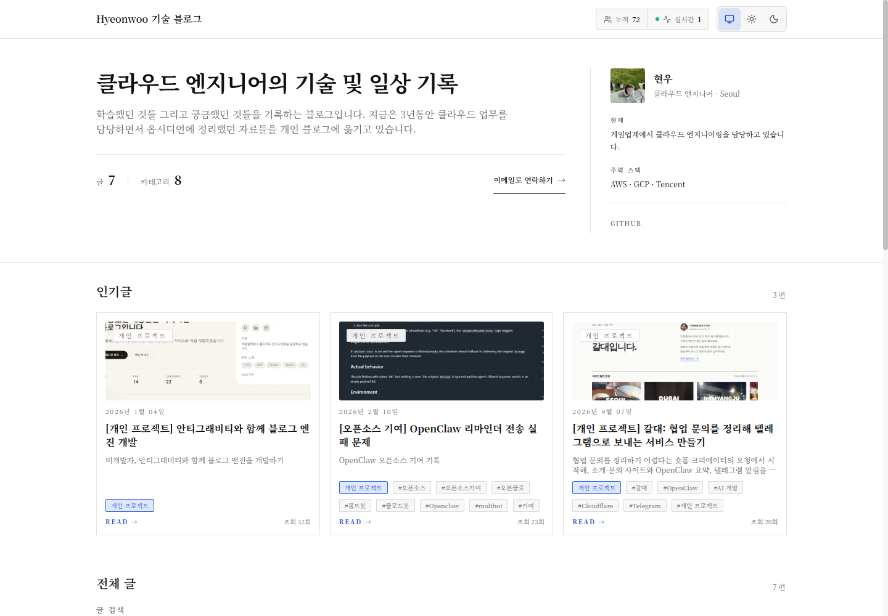
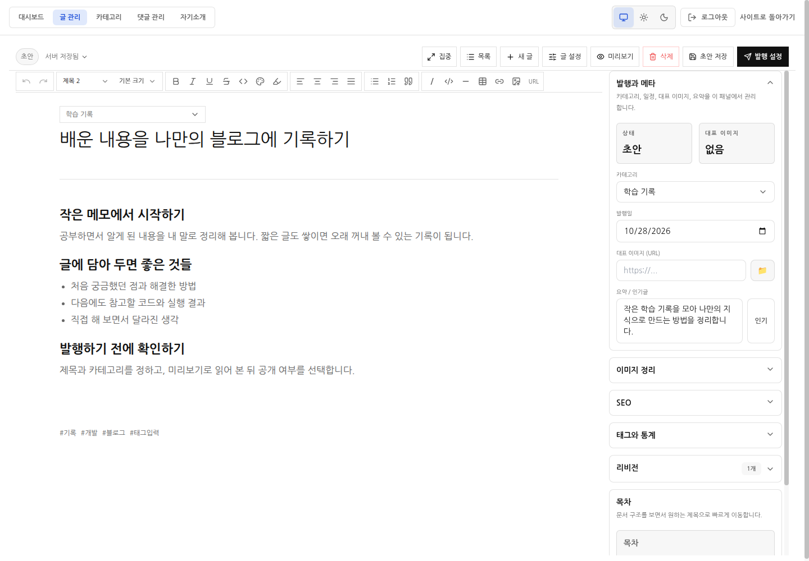

# Hamlog

**배운 내용과 개발 경험을 기록하는, 나만의 기술 블로그.**

Hamlog는 글을 쓰고, 이미지를 넣고, 발행한 글을 검색하며 방문 통계까지 확인할 수 있는 개인 기술 블로그 프로젝트입니다.
소스코드를 설치해 자신의 서버에서 직접 운영할 수 있고, 별도의 데이터베이스 서버 없이 글과 설정을 파일로 저장합니다.

**[운영 중인 블로그 둘러보기](https://tech.hamwoo.co.kr/)** · [화면 미리보기](#화면-미리보기) · [직접 실행하기](#직접-실행하기)

## 이런 분께 잘 맞아요

- 공부한 내용과 개발 경험을 꾸준히 기록하고 싶은 분
- 글쓰기부터 블로그 운영까지 자기 방식으로 관리하고 싶은 분
- 개인 블로그의 구조를 살펴보고 직접 설치하거나 수정해 보고 싶은 분

## 어떤 기능이 있나요?

| 하고 싶은 일 | Hamlog에서 할 수 있는 일 |
| --- | --- |
| 편하게 글쓰기 | 제목과 본문을 편집하고, 이미지를 붙여 넣거나 업로드하고, 코드 블록을 넣을 수 있습니다. |
| 글 정리하기 | 카테고리·태그·시리즈로 글을 묶고, 제목과 본문을 검색할 수 있습니다. |
| 긴 글 읽기 | 제목을 바탕으로 목차를 만들고, 같은 시리즈의 이전·다음 글로 이동할 수 있습니다. |
| 발행 관리하기 | 미리보기로 내용을 확인하고, 공개·비공개·예약 발행을 선택할 수 있습니다. |
| 수정 내용 되돌리기 | 브라우저 임시 저장본과 글 수정 이력을 확인하고, 휴지통의 글을 복원할 수 있습니다. |
| 방문 현황 확인하기 | 누적 방문자와 실시간 접속자를 보고, 관리자 화면에서 날짜별 방문 통계를 확인할 수 있습니다. |

## 화면 미리보기

### 블로그 홈

프로필과 글 목록을 둘러보고, 검색과 카테고리로 원하는 글을 찾을 수 있습니다.



### 글쓰기 화면

제목과 본문을 작성하고, 글 설정과 미리보기를 한 화면에서 다룰 수 있습니다.
아래 화면은 로컬 예시 데이터로 촬영했습니다.



## 어떻게 사용하나요?

### 글을 읽을 때

1. [운영 중인 블로그](https://tech.hamwoo.co.kr/)에서 관심 있는 글을 선택합니다.
2. 검색이나 카테고리·태그로 필요한 내용을 찾습니다.
3. 글의 목차와 시리즈 목록을 이용해 이어서 읽습니다.

### 직접 블로그를 운영할 때

자신이 설치한 Hamlog의 관리자 화면(`/admin`)에서 로그인한 뒤 글을 관리합니다.
운영 중인 예시 블로그의 관리자 화면은 해당 블로그 운영자만 이용할 수 있습니다.

1. **새 글**을 눌러 제목과 본문을 작성합니다.
2. 이미지·코드 블록을 넣고 카테고리와 태그를 정합니다.
3. **미리보기**에서 독자에게 보일 내용을 확인합니다.
4. **발행 설정**에서 공개 여부와 발행 시간을 정하고 저장합니다.
5. 관리자 대시보드에서 방문 통계를 확인하며 글을 관리합니다.

입력 내용은 현재 브라우저에 임시 보관됩니다. 다른 기기에서 이어 쓰려면 **초안 저장** 또는 **변경 저장**으로 서버에도 저장해 주세요.
자세한 편집 방법과 복구 동작은 [글쓰기 사용 안내](docs/technical-reference.md#editor-guide-admin)를 참고하세요.

## 직접 실행하기

Node.js 24와 npm 11 이상이 설치된 환경에서 실행할 수 있습니다.
아래는 내 컴퓨터에서 기능을 살펴보는 개발용 실행 방법입니다.

```bash
git clone https://github.com/jangmalza/Hamlog.git
cd Hamlog
npm ci
```

첫 번째 터미널에서 API 서버를 실행합니다. 아래는 macOS·Linux·Git Bash 기준이며, 비밀번호는 이 로컬 예시의 관리자 로그인에 사용합니다.

```bash
JWT_SECRET=local-preview-secret ADMIN_PASSWORD=local-preview-password npm run server
```

<details>
<summary>Windows PowerShell에서 실행하기</summary>

```powershell
$env:JWT_SECRET="local-preview-secret"
$env:ADMIN_PASSWORD="local-preview-password"
npm run server
```

</details>

두 번째 터미널에서 블로그 화면을 실행합니다.

```bash
npm run dev
```

- 블로그: [http://localhost:5173](http://localhost:5173)
- 관리자: [http://localhost:5173/admin](http://localhost:5173/admin)
- 위 예시의 관리자 비밀번호: `local-preview-password`

서버에 공개해 운영하려면 [환경변수 설정](docs/technical-reference.md#environment-variables)과 [Docker 실행 안내](docs/technical-reference.md#docker)를 먼저 확인하세요.

## 사용한 기술

| 영역 | 기술 |
| --- | --- |
| 블로그 화면 | React, TypeScript, Vite, Tailwind CSS |
| 글 편집기 | Tiptap |
| 서버 | Node.js, Express |
| 데이터 저장 | JSON 파일과 업로드 파일 |
| 배포 | Docker, GitHub Actions, 서버 배포 에이전트 |

## 더 자세히 알아보기

설치 옵션과 운영 절차는 [개발·운영 참고 문서](docs/technical-reference.md)에 정리했습니다.

- [로컬 개발과 테스트](docs/technical-reference.md#local-development)
- [환경변수와 로그인 설정](docs/technical-reference.md#environment-variables)
- [글 저장·복구 동작](docs/technical-reference.md#에디터-저장복구-동작)
- [자동 배포와 서버 에이전트](docs/technical-reference.md#cicd-github-actions)
- [데이터 백업과 복구](docs/technical-reference.md#backup-and-restore)
- [Cloudflare Access 로그인 설정](docs/cloudflare-access.md)
